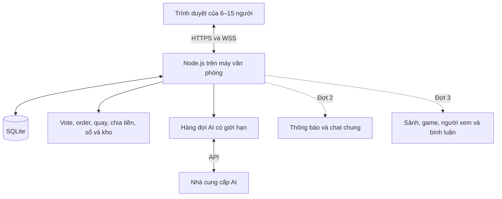

# Kiến trúc sau review độc lập — 12/11/2026

Quy mô 6 người hiện tại, tối đa 15 người. Đã đối chiếu PLAN-toi-gian.md và nhận một vòng review từ agent độc lập. Chốt nền tảng kỹ thuật dưới đây. Phân bổ khoản chênh làm tròn và nhà cung cấp AI còn là quyết định của Owner. Plan worker hiện cần Owner cập nhật theo mục đối chiếu cuối tài liệu trước khi giao triển khai.

## Nền tảng

Webapp dùng HTML/CSS/TypeScript, máy chủ Node.js bản LTS phù hợp Windows đích, SQLite trên ổ đĩa máy chủ và WebSocket cho cập nhật trực tiếp. Một gói giao diện cho đợt đầu. TypeScript giúp kiểm tra dữ liệu khi phát triển, hiệu năng chạy tương đương JavaScript tương ứng.

Ứng dụng chạy trên máy văn phòng, mọi người mở bằng trình duyệt. Máy chủ phục vụ giao diện, kiểm tra quyền và ghi dữ liệu chung. Khóa API cấu hình trên máy chủ, tách khỏi dữ liệu xuất và log. SQLite là nguồn dữ liệu chính. Trình duyệt giữ nháp giao diện và phiên đăng nhập.

## Phạm vi và kết hợp

- Đợt 1 gồm nền tảng máy chủ và toàn bộ phần ăn uống tối giản đang có trong plan, đồng bộ giữa các máy.
- Đợt 2 thêm thông báo và chat chung.
- Đợt 3 thêm game theo lượt, sảnh, người chơi, khán giả và bình luận.

Các phần dùng chung tài khoản, mã nhóm, kết nối và quyền theo tài nguyên. Mỗi bàn hoặc phòng có mã riêng. Sảnh về sau hiển thị trạng thái phòng và thành viên dựa trên kết nối thực tế. Tín hiệu kiểm tra định kỳ phát hiện mất kết nối. Nhiều tab cùng tài khoản được gộp thành một người. «Đang chơi» nghĩa là có ghế trong ván đang diễn ra. Các luật game và giao diện thuộc đợt quyết định sau.

## Đăng nhập và quyền

Chọn tài khoản nội bộ với tên đăng nhập duy nhất và PIN. Đề xuất PIN tối thiểu 6 chữ số, được băm kèm salt ở máy chủ, có giới hạn thử sai. Tên hiển thị tách khỏi mã thành viên cố định. Phiên đăng nhập lưu phía máy chủ, cookie HttpOnly, Secure, SameSite và có thể thu hồi. Người vận hành tạo tài khoản, cấp PIN ban đầu và đặt lại PIN khi cần. Đăng nhập cùng tài khoản trên máy khác nhận đúng danh tính.

Phần ăn uống có Chủ xị và Thành viên. Lưu hostId ở từng bàn để xác định người chịu trách nhiệm và khoản chênh nếu Owner chọn cách đó. Cấu hình API và quản lý tài khoản là quyền vận hành của người quản lý máy chủ. Vai trò chơi/xem chỉ xuất hiện ở đợt game.

Giữ quyền tự sửa các ô vòng quay theo tinh thần plan. Mọi lệnh vẫn được máy chủ kiểm tra danh tính, phạm vi dữ liệu và quyền cụ thể. Quyền sửa order của người khác phải được ghi rõ trong plan worker. WebSocket kiểm tra phiên và Origin, lệnh ghi qua HTTP có bảo vệ chống yêu cầu giả từ trang khác.

## Dữ liệu và đồng bộ

Máy chủ nhận thao tác có mã duy nhất, kiểm tra phiên bản, lưu thay đổi cùng mã thao tác và kết quả trong một giao dịch rồi phát cập nhật. Gửi lại sau mất mạng nhận lại kết quả cũ. Cùng một người chỉ có một phiếu hiệu lực trên một bàn. Các lệnh sửa xung đột nhận trạng thái mới để người dùng quyết định lại.

Mỗi người và quán dùng ID ổn định. Số bàn do cơ sở dữ liệu cấp duy nhất. Khi nối lại, trình duyệt tải trạng thái hiện tại. Giai đoạn chat bổ sung lấy tin còn thiếu theo ID. Sao lưu SQLite theo cách tạo bản sao nhất quán và thử phục hồi. Dữ liệu cũ từ trình duyệt được nhập một lần có mã đợt nhập chống trùng, xem trước và ánh xạ thành viên. Seed chỉ dùng khi tạo cơ sở dữ liệu mới.

Vòng quay do máy chủ lấy kết quả theo trọng số đã xác nhận. Lưu mã lượt quay, danh sách ô và trọng số tại thời điểm quay, kết quả và thời gian bắt đầu. Các máy diễn hoạt theo cùng kết quả. Mỗi vòng có tối đa một lượt đang quay. Sửa ô áp dụng cho lượt tiếp theo. Quay xong và bấm «CHỐT QUÁN NÀY» là hai thao tác riêng, nút chốt tham chiếu đúng lượt quay. Người vào muộn hoặc tải lại nhận đúng kết quả đã lưu.

## AI, ảnh và chia tiền

AI menu trả danh sách món gồm tên và giá có thể để trống. AI bill chỉ trả tổng tiền cuối cùng khách phải trả, dạng total hoặc null. Người dùng kiểm tra và sửa trước khi áp dụng. Chia tiền theo tỷ lệ giá order hoặc chia đều. Giá order thiếu xử lý theo quy tắc trung bình của plan và có nhãn ước tính.

Ảnh bill/menu chỉ giữ tạm trong bộ nhớ để xem và gửi AI. Ứng dụng không ghi ảnh vào SQLite, thư mục, log hay bản sao lưu. Dọn ảnh khi xong, hủy, lỗi hoặc hết hạn. Hàng đợi giới hạn cả số ảnh lẫn tổng dung lượng. Khởi động lại máy chủ khiến tác vụ đang dùng ảnh cần gửi lại. Lưu dữ liệu có cấu trúc đã duyệt và trạng thái tác vụ. Chính sách giữ ảnh ở nhà cung cấp API cần kiểm tra khi chọn dịch vụ.

Khởi đầu một tác vụ AI đồng thời trên máy đích, có timeout, giới hạn đầu vào và lỗi thân thiện để nhập tay. Ảnh được thu nhỏ phía trình duyệt, máy chủ vẫn kiểm tra kích thước và định dạng. Yêu cầu AI bất đồng bộ để máy chủ tiếp tục phục vụ vote. Thử lại không tự ghi đè bill đã sửa hoặc tạo món trùng. Nhà cung cấp chưa chốt, Claude là lựa chọn trong plan cũ. Khóa/model đặt tại máy chủ. Hạ tầng LAN miễn phí trên máy sẵn có, phí API và hạn mức tùy dịch vụ.

Cần sửa thuật toán plan trước triển khai. Bill null dùng tổng order, bill 0 là số 0 hợp lệ. Trường hợp không có người ăn cần xử lý riêng. Mọi khoản thu không âm, theo bước làm tròn 500 đồng. Ghi rõ khoản chênh thay vì kẹp âm rồi làm sai tổng. Đề xuất cho Owner là dùng tổng mục tiêu round500(tổng bill), phân bổ chênh giữa các suất bằng bước 500 đồng với quy tắc ổn định và không âm, khoản dưới 500 đồng giữa tổng mục tiêu và bill ghi riêng cho Chủ xị/quỹ chung. Đây là đề xuất đang chờ Owner chọn người chịu phần chênh.

## HTTPS và vận hành LAN

Chọn HTTPS cùng WSS để bảo vệ đăng nhập và hỗ trợ clipboard/chụp màn hình trên trình duyệt tương thích. Chứng chỉ cần khớp địa chỉ truy cập và được các thiết bị tin cậy. Dùng cơ quan cấp chứng chỉ nội bộ của văn phòng nếu có, hoặc triển khai CA nội bộ có quản lý. Cài chứng chỉ gốc công khai trên thiết bị tham gia và quản lý gia hạn; khóa riêng của CA chỉ giữ ở nơi vận hành.

mkcert phù hợp thử nghiệm phát triển. Chính dự án lưu ý phạm vi phát triển, nên cần phân biệt cấu hình thử nghiệm với cấu hình vận hành. HTTPS không mở được chức năng chụp màn hình trên trình duyệt vốn không hỗ trợ. Luôn có chọn file và dán ảnh bằng thao tác người dùng. Khi sao chép tự động bị từ chối, hiện nội dung để chọn và copy thủ công. execCommand là API lỗi thời, không dùng làm điều kiện bảo đảm nghiệm thu.

Đặt địa chỉ cố định bằng DHCP reservation trên router hoặc IP tĩnh hợp lệ. Tên MAY3 chỉ dùng sau khi kiểm tra điện thoại phân giải được. Máy chủ tự khởi động cùng Windows, tự chạy lại khi tiến trình lỗi và tắt ngủ khi cắm điện trong giờ dùng. Tường lửa chỉ mở cổng cần thiết cho mạng văn phòng. Kiểm tra mạng Wi-Fi khách có chặn truy cập LAN hay không. Mất điện hoặc tắt máy chủ làm gián đoạn sử dụng, dữ liệu đã ghi được khôi phục khi máy chạy lại.

Nguồn kiểm tra
- https://developer.mozilla.org/en-US/docs/Web/API/MediaDevices/getDisplayMedia
- https://developer.mozilla.org/en-US/docs/Web/API/Clipboard/writeText
- https://github.com/FiloSottile/mkcert

## Máy đích và tiêu chí kiểm thử

Báo cáo DxDiag do Owner gửi ngày 12/11/2026 xác nhận Pentium Gold G6405 4,10 GHz, RAM 8 GB, Windows 10 Pro build 19043, đồ họa UHD 610. CPU có 2 lõi và 4 luồng theo Intel. Ổ KINGSTON SA400S37480G, phân vùng C còn 45,8 GB và D còn 308,7 GB theo báo cáo. Bộ điều khiển mạng Realtek PCIe GbE được liệt kê, tốc độ liên kết hiện tại chưa được đo. Dòng Available OS Memory là RAM hệ điều hành sử dụng được, không phải RAM đang rảnh. DxDiag chưa cho biết CPU và bộ nhớ trống trong giờ làm việc.

Đánh giá dự kiến là đủ để phục vụ 15 người vote, chat chữ, chơi cờ theo lượt và xem ván, với AI đọc ảnh qua API. Hiệu ứng chạy trên máy người dùng. Khả năng dư tải trong giờ làm việc cần đo. Không suy ra máy đang thiếu RAM hoặc rò rỉ bộ nhớ chỉ từ dòng Page File hay lịch sử lỗi DxDiag.

Mục tiêu nghiệm thu ban đầu là 95% thao tác trực tiếp đến máy khác trong 500 ms trên LAN ổn định; bộ nhớ máy chủ và ảnh có giới hạn trong ngân sách khoảng 1 GB. Đây là mục tiêu, chưa phải số đo. Máy MAY3 chạy ứng dụng đã build. Máy phát triển khác chạy build và các trình duyệt E2E để tránh trộn tải kiểm thử với tải máy chủ.

Codex thực hiện kiểm thử mỗi đợt với 15 tài khoản, kiểm tra quyền, nhiều tab, thay đổi đồng thời, gửi trùng, mất mạng và khởi động lại. Đợt ăn uống bao gồm đầy đủ vote, order, quay, chia tiền, sổ và kho. AI thử bằng menu/bill thật, ảnh mờ, timeout, dữ liệu sai và sửa tay. Kiểm tra copy/chụp màn hình trên Chrome/Edge desktop và chọn ảnh trên điện thoại thật khi thiết bị có thể truy cập. Đo trong lúc máy làm công việc văn phòng thông thường, ghi rõ giới hạn kiểm chứng.

Nguồn CPU
https://www.intel.com/content/www/us/en/products/sku/201901/intel-pentium-gold-g6405-processor-4m-cache-4-10-ghz/specifications.html

## Kết quả review và đối chiếu plan worker

Review độc lập chấp nhận nền tảng và yêu cầu sửa các mâu thuẫn. Các dòng sau thuộc PLAN-toi-gian.md ngày review.

| Mức | Vị trí và vấn đề | Cách xử lý trong phương án này |
| --- | --- | --- |
| P1 | Dòng 14, 210, 315 chỉ dùng tổng bill; kiến trúc trước đưa lại dòng món/gán người | Đã sửa kiến trúc về tổng bill và order |
| P1 | Dòng 32, 78–83, 312 đặt dữ liệu/key trong trình duyệt | Máy chủ giữ dữ liệu/key; thay luồng tải/lưu và nhập dữ liệu cũ |
| P1 | Dòng 305 chụp màn hình cần môi trường an toàn | HTTPS tin cậy và đường dự phòng theo trình duyệt |
| P1 | Dòng 73 đăng nhập chưa phù hợp kiến trúc LAN | Tài khoản nội bộ, PIN, phiên máy chủ |
| P1 | Dòng 82, 291 yêu cầu không lưu ảnh | Ảnh tạm trong bộ nhớ, dữ liệu đã duyệt lưu SQLite |
| P1 | Dòng 183–190 chọn kết quả cục bộ rồi chốt | Máy chủ tạo lượt quay, chốt quán là thao tác riêng |
| P1 | Dòng 106 bỏ host, dòng 245 lại dùng Chủ xị nhận dư | Thêm hostId tại bàn |
| P1 | Dòng 241, 247, 249 xử lý bill trống và dư sai | Bill null khác 0, bảo toàn tổng cùng khoản chênh, xử lý không có người |
| P2 | Dòng 74–75 còn Phó, kiến trúc trước thêm nhiều cấp | Chủ xị/Thành viên cho ăn uống, quyền vận hành riêng |
| P2 | Dòng 359–360 để realtime và proxy ra ngoài phạm vi | Đưa hai phần vào nền tảng đợt 1 |
| P3 | Tải mã từng vùng, nguồn giá AI gợi ý nhà cung cấp | Một gói giao diện, nhà cung cấp chưa chốt |

Ví dụ lỗi làm tròn độc lập tìm thấy trong plan cũ. Bốn người chia 1.000 đồng, làm tròn riêng thành 500 đồng mỗi người tạo tổng 2.000 đồng. Dồn dư âm 1.000 đồng vào một người rồi kẹp về 0 khiến tổng còn 1.500 đồng. Ngoài ra bill 100.100 đồng không thể bằng tổng các khoản đều là bội 500. Cần ghi khoản chênh riêng và Owner chốt người chịu, trước khi triển khai tính tiền.

Điểm phản biện cần chỉnh cách diễn đạt. Cấu trúc một file HTML có thể gọi máy chủ được; chính dữ liệu riêng từng trình duyệt và key phía client là phần phải thay. WebSocket phù hợp nhưng SSE vẫn đáp ứng các game theo lượt; chọn WebSocket để thống nhất kênh hai chiều, không phải vì 15 người bắt buộc dùng. HTTPS là điều kiện cần, khả năng API vẫn phụ thuộc trình duyệt. Đây là review tài liệu và nguồn kỹ thuật, chưa phải nghiệm thu runtime.
